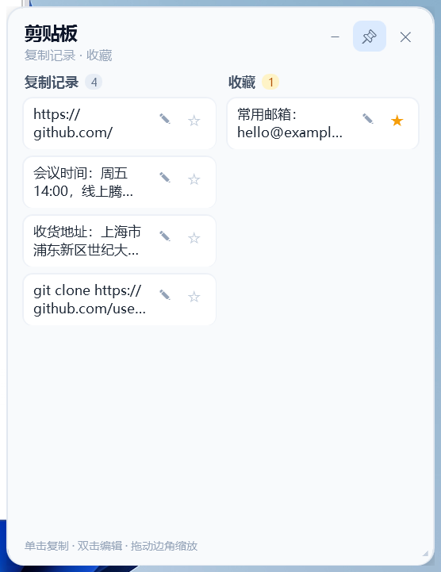
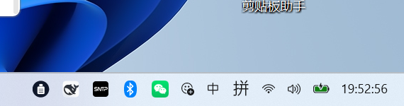

# 剪贴板助手 · Clipboard Widget

[](https://github.com/seoulzhc/clipboard-widget/releases/latest)
[](LICENSE)

**[⬇ 下载最新版本](https://github.com/seoulzhc/clipboard-widget/releases/latest)**

一个零依赖的 Windows 剪贴板历史小工具：一块无边框、可置顶的卡片常驻桌面，自动记录你复制的文字，常用的可以点星收藏。



## 功能

- **自动记录**：监听剪贴板，保留最近 60 条复制的文字。
- **两栏布局**：左边「复制记录」，右边「收藏」。
- **点星收藏**：任意一条点 ☆ 就出现在收藏栏，点 ★ 取消收藏。
- **单击复制、双击编辑**：也可以点条目上的 ✎；`Ctrl+Enter` 保存，`Esc` 取消。
- **四个角都能拉**：拖任意一个角整体等比缩放（0.6～1.6 倍），大小和位置自动记住。
- **置顶 / 移动**：📌 切换置顶，拖动标题栏移动卡片。
- **收起到托盘**：点标题栏 `−`，卡片收起，任务栏右下角出现托盘图标；点图标即可展开。
- **纯本地**：数据保存在 `%APPDATA%\ClipboardWidget\data.json`，不联网、不上传、无遥测。

## 截图

| 面板 | 托盘 |
| --- | --- |
|  |  |

## 环境要求

- Windows 10 / Windows 11
- Windows PowerShell 5.1（系统自带）
- 不需要管理员权限，不需要安装任何模块

## 安装

1. 下载本仓库（Code → Download ZIP），解压到任意目录，例如 `C:\Tools\ClipboardWidget`。
2. 双击 **install.cmd**（或在 PowerShell 里运行 `install.ps1`）。它会创建桌面快捷方式和开机启动快捷方式，并启动小工具。
3. 不想开机自启：`powershell -ExecutionPolicy Bypass -File install.ps1 -NoStartup`

不想安装、只运行一次：

```powershell
powershell -Sta -NoProfile -ExecutionPolicy Bypass -File .\clipboard-widget.ps1
```

## 使用方法

| 操作 | 方式 |
| --- | --- |
| 再次复制某一条 | 单击条目 |
| 编辑某一条 | 双击条目，或点条目上的 ✎ |
| 收藏 / 取消收藏 | 条目上的 ☆ / ★ |
| 缩放面板 | 拖动任意一个角 |
| 移动面板 | 拖动标题栏 |
| 置顶开关 | 📌 |
| 收起 | `−` |
| 从托盘展开 | 左键单击或双击托盘图标 |
| 退出 | ✕，或托盘图标右键 → 退出 |

## 数据与隐私

- 记录和收藏保存在 `%APPDATA%\ClipboardWidget\data.json`，是明文 JSON（最多 60 条记录、200 条收藏）。
- 只读取剪贴板里的文字，不记录图片和文件。
- 程序不联网。如果复制过密码等敏感内容，请及时删除对应条目或清空该文件。

## 卸载

- 运行 **uninstall.cmd**：删除快捷方式和 `%APPDATA%\ClipboardWidget`。
- 或者手动删除文件夹和两个快捷方式。

## 说明与限制

- Windows 11 上托盘图标可能先出现在 `^` 溢出菜单里，把它拖到任务栏上固定一次即可。
- 编辑只修改记录里的文字，不会改变当前剪贴板内容。
- 默认置顶，点 📌 可以取消置顶。
- 只支持文字，不支持图片和文件历史。

## 许可证

MIT，详见 [LICENSE](LICENSE)。
